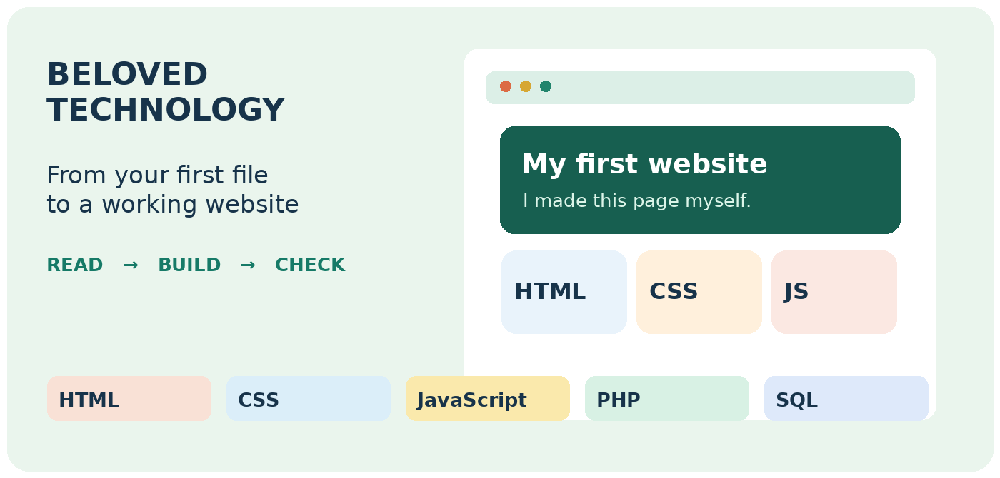

# Website Design with AI
### A self-paced practical course by Paul Victor · Beloved Technology

Start with computer basics and learn to build websites one practical at a time. No previous computer experience is required. The handout uses colourful diagrams, clickable navigation, short explanations, practice tasks and checks you can complete yourself.

## Downloads

| What you need | Download |
|---|---|
| Read on your phone with adjustable text and Copy code | [Download the mobile HTML reader](downloads/Website_Design_Mobile_Reader.html?raw=true) |
| Read the complete course | [Download the PDF](downloads/Practical_Website_Design_with_AI.pdf?raw=true) |
| Edit or print your own copy | [Download the Word handout](downloads/Practical_Website_Design_with_AI.docx?raw=true) |
| Get the practice projects | [Download the practice ZIP](downloads/Website_Design_Practice_Files.zip?raw=true) |

If GitHub opens a file preview, choose **Download raw file**. You do not need a GitHub account to download these public files.

## Start here

1. Download the mobile HTML reader or PDF, plus the practice ZIP above. Open the HTML file in a full browser; a phone’s file preview may not run its controls. Use the PDF if your phone cannot open local HTML.
2. Read **Welcome to your first website** and **Download your course files** in the book.
3. Right-click the ZIP in Windows → **Extract All**. Open the extracted folder.
4. Open **START_HERE.html** for a clickable exercise index. Copy an exercise to your own **My Practice** folder before editing it.
5. Start at Part 01. In the reader, use the menu, lesson search, Back/Next, Aa text controls and completion buttons. In the PDF, use the clickable contents and footer Contents link.

## What you will practise

| Part | Work you will complete |
|---|---|
| Computer and internet | Mouse, keyboard, files, browsers, DNS, requests, servers and hosting |
| Your first webpage | Notepad, saving HTML, VS Code and Live Server |
| HTML | Five practicals covering structure, lists, tables, images, links and forms |
| CSS | Five practicals covering appearance, spacing, navigation, responsive grids and forms |
| JavaScript | Five practicals covering a greeting, calculator, catalogue, toggle and search |
| PHP | Five practicals covering server output, calculations, lists, validated forms and sessions |
| SQL | Five practicals covering tables, queries, changes, joins and transactions |
| Combined websites | Bakery, clothing enquiries, training courses, guesthouse enquiries and event registration |
| AI and next steps | Codex, Qoder, WordPress, Blogger, Google Sites, Dreamweaver, Laravel, Django, Flutter, React and publishing |

The five complete websites share a small, explained PHP and SQLite application and adapt it to five sets of content and business rules. Each has four pages, its own folder, setup steps and acceptance checks. The handout explains the shared code before the adaptations.

## Running the files

- **HTML/CSS/JavaScript:** open `index.html` in a browser, or use Live Server in VS Code.
- **PHP practicals:** open the practical folder in VS Code, choose Terminal → New Terminal, run `php -S 127.0.0.1:8000`, then visit `http://127.0.0.1:8000/index.php`.
- **SQL:** use DB Browser for SQLite. Run practicals 1–5 in order in one new database.
- **Complete websites:** requires PHP with PDO and pdo_sqlite. In one website folder, run `php setup.php`, then `php -S 127.0.0.1:8000 -t public`. Read its `README.txt` before starting.

Stop a running server with Ctrl + C before starting another project on the same port. The PHP database belongs outside the public folder. GitHub hosts these downloadable files; it does not run the PHP applications.

## About the author

Paul Victor is a web developer, ICT trainer and digital media creator. His experience includes teaching programming, website development, database systems and other computer subjects at Theofadek Business and Computer Studies. His portfolio includes BelovedSubP and Beloved College. He also creates educational and technology content through Beloved Technology and Beloved Technology Media.

This short profile is based on the author's supplied CVs, teaching application and portfolio. Those private source documents are not included in this repository.

## Learning scope and checks

Examples use fictional names and sample prices. The complete websites record local enquiries; they do not take payments, confirm admissions, allocate rooms or issue tickets. Public deployment requires further work and review.

The phone edition uses 19-point explanations in a narrow PDF, with the original 9.5-point code size preserved. The HTML reader has adjustable explanations, 96 copy boxes, searchable contents, optional dark mode and progress saved on the current device. Its 188 lessons include 13 new lessons on Paul’s AI-to-GitHub-to-server workflow.

All 25 foundation practicals were run: SQL in SQLite, and HTML/CSS/JavaScript/PHP using Chromium and PHP in GitHub Actions. The five complete websites were started and their home, catalogue, request and saved-result pages captured. The handout includes 46 real browser captures and selected privacy-safe interface crops supplied by Paul. The original 104 practice code files are unchanged. These checks do not constitute a production security audit.

The AI workflow covers optional ChatGPT planning, Codex and Kilo in VS Code, Cline, Claude Code, Qoder, local testing, GitHub Desktop, reviewed agent pushes and Laravel server deployment. Google’s consumer Gemini Code Assist migration is explained. Free access and credits depend on current accounts and providers. No deployment to a personal or business server was performed.

Self-paced edition · October 2026. Tool menus and account plans can change; official reference links are included in the handout.
